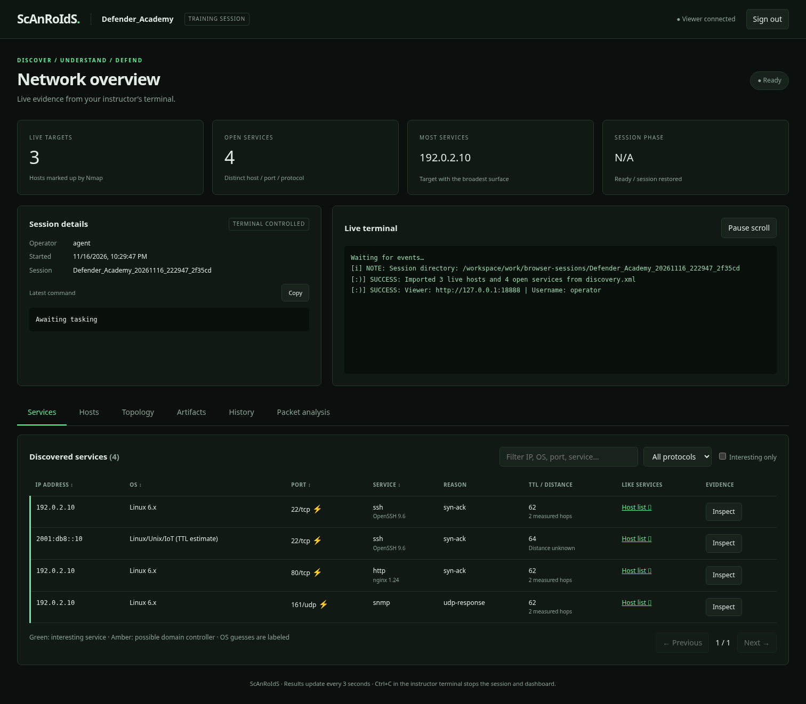

# ScAnRoIdS

An instructor-controlled network discovery and audit workspace for Kali Linux and custom Debian training builds. Start and stop scans in the terminal; authenticated viewers on the same LAN follow results, logs and evidence in their browsers.



## Install and check dependencies

Requires Python 3.11+, Nmap, and dumpcap when capture is enabled. Optional tools are listed with their executable/package names in [Tools and installation](docs/TOOLS.md).

```bash
./setup_scanRoids.sh
.venv/bin/python main.py --doctor
```

The setup script creates `.venv` beside the source and installs Python dependencies. You manage system packages. For an exact Python dependency set, install `requirements-lock.txt` instead of the version ranges.

## Start an instructor session

```bash
sudo .venv/bin/python main.py --customer CourseLab --interface any
```

The supplied scan menu is preserved. Select an ID and provide an IP, CIDR, IPv4 last-octet range, or `-iL /path/to/hosts.txt`. Discovery, auditing and optional tool offers stay in the terminal. The viewer listens on port 8888. Use the Kali machine's LAN address from other workstations.

During a session, use **`b` = back** at an option prompt to cancel the remaining workflow and return to the main scan-ID prompt. Use **`q` = exit** to end the session and close the dashboard, including from a nested prompt. Completed scans and saved artifacts are retained. At the main menu, `b` simply redraws the menu. These commands are recognized while awaiting input; Ctrl+C remains the way to interrupt an actively running job/session.

Default viewer credentials are `operator` / `CourseLab_<current-year>`. Set `SCANROIDS_PASSWORD` to override the password. After a scan, the viewer stays available and the terminal accepts more jobs. Ctrl+C or `q` stops the session and server.

Code may live wherever you choose, including `/tools/scripts/ScAnRoIdS`. Session data defaults to `/tools/scans/ScAnRoIdS`; override it with `--data-dir` or `SCANROIDS_DATA_DIR`.

## Import and view a previous scan

```bash
.venv/bin/python main.py --customer PreviousLab --data-dir ./sessions \
  --import /path/to/discovery.xml --view-only
```

Repeat `--import` to combine XML/GNMAP files. Viewing and importing need no root privileges or scan tools. Original evidence is retained in the session directory. The read-only dashboard has no scan-control endpoints.

Try the bundled synthetic evidence without scanning anything:

```bash
.venv/bin/python main.py --customer Demo --data-dir ./sessions \
  --import tests/fixtures/discovery.xml --view-only
```

## Resume, plan, and automate

```bash
# Adopt an existing session without deleting its databases or artifacts.
.venv/bin/python main.py --resume /path/to/session --view-only

# Inspect command/capture scope without launching any tools.
.venv/bin/python main.py --customer Plan --data-dir ./sessions \
  --scan 40 --targets 192.0.2.0/28 --dry-run

# Run one requested scan without prompts, then exit.
sudo .venv/bin/python main.py --customer CourseLab --interface any \
  --scan 40 --targets 192.0.2.0/28 --non-interactive --exit-after

# Audit discovered open ports in an existing session, then exit.
sudo .venv/bin/python main.py --resume /path/to/session --interface eth0 \
  --scan 50 --non-interactive --exit-after

# Use a course profile; explicit CLI arguments override saved settings.
.venv/bin/python main.py --customer Plan --data-dir ./sessions \
  --profile profiles/discovery.json --dry-run
```

Documentation ranges above are placeholders; substitute your training network. `--audit` continues discovery into an audit. `--include-industrial` explicitly includes discovered ICS ports; `--expand-all-ports` confirms scan 52's expanded scope. `--tools --greedy` runs applicable enumeration adapters automatically in batch mode. Custom phase-2 audit flags use `--scan 99 --phase 2 --flags '...'`.

`--no-capture` disables packet capture explicitly. `--no-dashboard` runs only the terminal workflow. `--host` and `--port` control the viewer listener. Routed scans capture on Linux `any` by default; `--interface any` selects it explicitly. If you select a physical capture interface, it must match the target route (`ip route get <target>`). Local ARP/multicast discovery requires a physical interface. Run `--help` for all options.

## Teaching and extension

The viewer provides service and host tables, service-specific copy commands, measured route visualization, execution history, a screenshot gallery, artifact downloads and PCAP analysis recipes. Terminal session commands also support offline PCAP analysis and comparisons between saved sessions.

Read [Architecture](docs/ARCHITECTURE.md), [Release notes and limits](docs/RELEASE_NOTES.md), and [Validation](docs/VALIDATION.md) before lab acceptance testing. Each adapter has an individual entry function and uses a shared process/capture/logging layer.

## Tests

```bash
.venv/bin/python -m pip install -r requirements-dev.txt
.venv/bin/python -m pytest -q
.venv/bin/ruff check main.py config.py core modules tests
.venv/bin/ruff format --check main.py config.py core modules tests
```

Tests use synthetic scan files and local subprocesses. The optional real Nmap integration runs against a temporary loopback service only:

```bash
SCANROIDS_NMAP_INTEGRATION=1 .venv/bin/python -m pytest -q tests/test_nmap_integration.py
```

Use this resource for networks and training systems you are authorized to assess.
